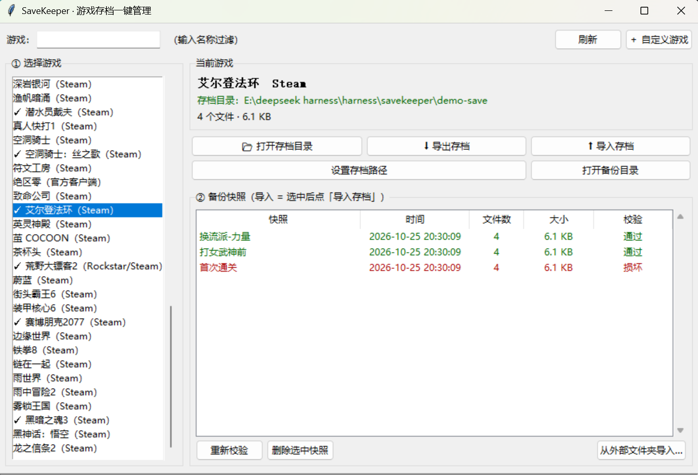

# SaveKeeper · 游戏存档一键管理工具

> 一键打开存档目录，快速备份 / 还原 / 校验游戏存档。
> **不改游戏本体，只操作存档目录内的文件。零第三方依赖，解压即用。**




---

## 为什么做这个

游戏存档散落在 `%APPDATA%`、`Documents`、Steam `userdata` 各个角落，手动翻文件夹找半天、还容易找错。
换机器、重装系统、想回退到某个 BOSS 战前，只能靠"我记得复制过一个文件夹"。

SaveKeeper 把这件事压缩成两步：**选游戏 → 点按钮**。

| 功能 | 说明 |
|---|---|
| 📂 **一键打开存档目录** | 自动检测，直接定位到存档所在文件夹；**双击游戏名就开** |
| ⬇ **导出存档** | 完整快照存档目录，带 SHA-256 清单 |
| ⬆ **导入存档** | **直接选 zip**：自动解压、自动定位存档子目录、**导入前预览差异**；导入前自动备份当前存档，随时可回退；**双击快照直接换档** |
| 🛡 **游戏运行时就拦住** | 检测到游戏进程在跑会阻止换档 —— 否则退出时内存存档会覆盖掉刚换好的文件 |
| 📤 **导出快照成文件夹** | 把一个备份导成普通文件夹，方便发给别人或传网盘 |
| 🔍 **完整性校验** | 导入前逐文件校验 SHA-256，校验失败**阻止覆盖**并报错 |
| 🗂 **自定义游戏** | 内置库没有的游戏，手动指定路径即可 |
| 💻 **CLI + GUI** | 图形界面为主，命令行同样全功能（脚本 / 无桌面环境可用） |
| 🎮 **内置 73 款游戏路径** | 自动检测；库里没有的用「自定义游戏」手动指定 |
| 🔎 **自动发现新游戏** | 扫描本机已装游戏（Steam / Epic / 注册表）逐个找存档，内置库装不下的也认 |
| 📁 **从游戏文件夹反推存档** | 绿色版 / 破解版没有 Steam 清单？指一下游戏本体目录，它自己找存档在哪 |

---

## 快速开始

### 方式 A：下载打包版（推荐普通用户）

到 [Releases](../../releases) 下载 `SaveKeeper-Windows.zip`，解压后双击里面的 `SaveKeeper.exe` 即可，
无需安装 Python。

> 解压后请保持文件夹结构完整（`SaveKeeper.exe` 需要同目录下的 `_internal`），
> 想放桌面的话建个快捷方式，不要只把 exe 单独拖出来。

### 方式 B：从源码运行

```bash
git clone https://github.com/hgkbz114514/SaveKeeper.git
cd SaveKeeper

# GUI（主用法）
python -m savekeeper.gui

# 或命令行
python -m savekeeper list
```

> 运行时**零第三方依赖**，只用 Python 标准库（Python 3.9+）。
> 需要 tkinter —— Windows 官方安装包默认自带；Linux 装 `python3-tk`。

### 方式 C：自己打包 exe

```bash
pip install pyinstaller
python -m PyInstaller SaveKeeper.spec --noconfirm --clean
```

产物在 `dist/SaveKeeper/SaveKeeper.exe`（整个 `dist/SaveKeeper/` 目录一起分发）。

> 用的是 onedir 而不是 onefile：onefile 每次启动都要把自己解压到 `%TEMP%`，
> 在受限 TEMP 环境里会直接报 `Could not create temporary directory`，
> 而且更容易被杀软盯上。onedir 启动更快、更稳。

---

## 使用说明

### GUI 主界面（操作 ≤ 2 步）


**打开存档目录**：双击左侧游戏名，一步到位。或者选中游戏点「📂 打开存档目录」。

**换档（还原）**：双击右侧快照列表里的那一条 —— 校验通过就直接换好，导入前自动把当前存档备份一份。走「⬆ 导入存档」按钮会先问一次确认。

**右键快照**还有：导出成一个文件夹（发给别人 / 传网盘）、在资源管理器里查看、删除。

如果检测到游戏正在运行，换档会被拦下 —— 多数游戏退出时会把内存里的存档写回去，刚换好的文件会被覆盖。先完全退出游戏再换。

**游戏不在列表里？** 顶部两个按钮：

- **「＋ 从游戏文件夹添加」** —— 选游戏本体目录（含 `.exe` 那层），它反推存档位置并给你看依据，确认后入列。绿色版、破解版、刚下的新游戏都走这条。
- **「＋ 自定义游戏」** —— 你已经知道存档在哪，直接手动指定。

### 命令行

```bash
# 列出全部游戏 + 自动检测结果
python -m savekeeper list

# 扫描本机已装游戏，自动探测每款的存档目录
python -m savekeeper scan
python -m savekeeper scan --verbose --save

# 从游戏本体文件夹反推存档（绿色版/破解版靠这个）
python -m savekeeper scan-install "D:/Games/新下的游戏"
python -m savekeeper scan-install "D:/Games/新下的游戏" --save --open

# 看最近谁动过存档（先进游戏存一次档）
python -m savekeeper recent --days 30

# 一键打开存档目录
python -m savekeeper open eldenring

# 导出存档（--label 加备注）
python -m savekeeper export eldenring --label "通关前"

# 查看某游戏的所有备份
python -m savekeeper snapshots eldenring

# 一步换档（校验 → 自动备份当前存档 → 覆盖）
python -m savekeeper swap eldenring 通关前_20261025_200946

# 回滚到最新一个可用快照
python -m savekeeper latest eldenring

# 把快照导成一个独立文件夹（发给别人 / 传网盘）
python -m savekeeper export-snapshot eldenring 通关前_20261025_200946 "D:/存档分享"

# 还原（覆盖前自动备份当前存档）
python -m savekeeper import eldenring --snapshot 20261025_200946

# 从外部文件夹导入
python -m savekeeper import eldenring --from "D:/别人分享的存档"

# 手动指定存档路径（自动检测失败时）
python -m savekeeper setpath eldenring "C:\Users\你\AppData\Roaming\EldenRing"

# 添加自定义游戏
python -m savekeeper add "潜水员戴夫" "C:\...\AppData\LocalLow\Mintrocket\dave the diver"

# 校验某个快照是否完整
python -m savekeeper verify "C:\Users\你\Documents\SaveKeeper-Backups\eldenring\xxx"
```

---

## 存档路径是怎么找到的

**内置游戏库已收录 73 款游戏**（艾尔登法环、博德之门3、黑神话：悟空、原神、星露谷物语、
GTA5、赛博朋克2077、幻兽帕鲁、潜水员戴夫、死亡细胞……），完整列表在 `savekeeper/games.py`。

**但内置库不是全部。** 刚下的新游戏、绿色版、破解版都不在其中，所以还有三条自动发现的
路子，一条比一条管用（全部**只读**探测，不写任何文件）：

### 路子 1：`scan` —— 扫描本机已装游戏

```bash
python -m savekeeper scan            # 扫 Steam / Epic / 注册表里的游戏，逐个找存档
python -m savekeeper scan --verbose  # 显示每款的判定依据
python -m savekeeper scan --save     # 命中的写进配置，之后可直接按游戏名操作
```

判断依据是四条独立线索交叉，不靠猜文件夹名：

1. **Steam 云存档** —— 有 appid 就能直接定位 `userdata/<uid>/<appid>`，与游戏名无关
2. **已装清单** —— 解析 Steam 的 `appmanifest_*.acf`、Epic 的 `*.item`、注册表 Uninstall 项
3. **名字反查** —— 拿产品名去 `AppData` / `Documents/My Games` / `Saved Games`
   反查 `<公司>/<游戏>` 两级布局（Rockstar、CDPR、Unity 游戏都这么存）
4. **内容验证** —— 名字对上还不够，必须真的含存档文件，否则会把崩溃日志目录当存档

### 路子 2：`scan-install` —— 从游戏本体文件夹反推

这是给**绿色版 / 破解版 / 刚下的新游戏**准备的：它们没有 Steam 清单，但一定有本体目录。

```bash
python -m savekeeper scan-install "D:/Games/SomeGame"
python -m savekeeper scan-install "D:/Games/SomeGame" --save --open
```

图形界面里对应顶部按钮 **「＋ 从游戏文件夹添加」**，选完就能看到判定依据与置信度，
确认后直接进列表，之后一键打开。

反推时会看这些东西：

- 本体里的 `steam_api64.dll` / `steam_appid.txt` / 注册表 → 拿到 appid，走云存档精确链路
- 本体内 `savedata/`、`saves/`、`win64_save/` 这类目录（**并且验证里面真有存档**）
- exe 的版本资源（产品名 / 公司名）→ 去 AppData 下反查
- 引擎特征（Unity / Unreal / Godot / RPGMaker / Ren'Py）→ 按引擎惯例展开
- `steam_autocloud.vdf` → Steam 自己塞的云同步标记，文件在就等于"这里是存档目录"

### 路子 3：`recent` —— 看最近谁动过存档

```bash
python -m savekeeper recent --days 30
```

不确定游戏把存档写哪儿时，先进游戏存一次档，再跑这个，最近改动过的目录会排在最前面。
会自动排除缓存、临时目录、崩溃转储和软件更新器。

### 兜底：手动指定

```bash
python -m savekeeper setpath eldenring "D:/Save/EldenRing"
python -m savekeeper add "我的游戏" "D:/Save/MyGame"
```

Steam 安装目录从注册表 `HKCU\Software\Valve\Steam` 读取，只读不写。

---

## 那些容易踩的坑

自动定位最难的不是"找目录"，是**认得出真假**。实测遇到过的：

| 现象 | 真相 | 现在怎么处理 |
| --- | --- | --- |
| `savedata/` 里有 `save0121.dat`，看着像存档 | 两个不同游戏里这个文件的 SHA-256 完全相同 —— 23 KB 的模板占位档 | 评分把**存档数量与总体量**算进去，真存档（10 份 × 260 KB）排第一 |
| `AppData/Rockstar Games/RDR2` 名字完全对 | 里面只有 `CrashLogs/settings.dat` | 崩溃/日志路径整段跳过，不参与判定 |
| `AppData/Local/CDPR/Cyberpunk 2077` 名字完全对 | 只有 `UserSettings.json` | `.json` 默认算弱证据，除非文件名带 save/profile |
| `AppData/Local/Draw&Guess` 扩展名一个都不认识 | 里面全是 `.dgm`/`.dgwl`，但有 `steam_autocloud.vdf` | 云同步标记直接认定为存档目录 |
| `recent` 列出 `Temp/hindsight-dsh` | 只看最后一级目录名，父级是 `Temp` 没被抓到 | 改成检查完整路径的每一层 |
| `recent` 列出 Telegram / 豆包 / Quark 更新器 | AppData 下到处是 `.json`/`.db` | 本地目录必须命中游戏存档特征（`LocalLow`、`My Games`、强扩展名）才展示 |

---

## 备份目录结构

```
%USERPROFILE%/Documents/SaveKeeper-Backups/
└── eldenring/                                  # 游戏 id
    ├── 打女武神前_20261025_203009/              # 快照（备注_时间戳）
    │   ├── manifest.json                       # 清单：每个文件的 SHA-256 / 大小 / mtime
    │   └── data/                               # 存档目录的完整镜像
    │       ├── ER0000.sl2
    │       └── steam_autocloud.vdf
    └── 20261025_200946/                        # 导入前的自动备份（可回退）
```

备份根目录不是写死在「文档」下，会按下面顺序挑**第一个真正可写**的位置：

1. 你在「设置」里指定的目录
2. `%USERPROFILE%/Documents/SaveKeeper-Backups`
3. `%LOCALAPPDATA%/SaveKeeper/backups`
4. `%USERPROFILE%/SaveKeeper-Backups`

> 之所以要兜底：「文档」目录经常被 OneDrive 重定向、被企业策略或
> Windows **受控文件夹访问**锁住——未签名的新 exe 往里写会直接 `WinError 5 拒绝访问`。
> 现在遇到这种情况会自动换到下一个可写位置，程序照常能用。

快照文件夹名保留中文备注（NTFS 本身就是 UTF-16，中文路径完全合法），
只替换 `<>:"/\|?*` 这些真正非法的字符、去掉首尾空格与点、超过 40 字符截断。
备注原文另存在 `manifest.json` 的 `label` 字段里，改名不影响校验。

---

## 安全设计

| 约束 | 实现 |
|---|---|
| 不修改游戏本体 | 只对存档目录做**读取**和**写入存档目录内**，绝不碰游戏 exe / 注册表 / 配置 |
| 导入前必须校验 | `verify_snapshot()` 逐文件比对 SHA-256，**任何一项不符即抛 `IntegrityError` 中止**，一个字节都不会被覆盖 |
| 导入前自动备份 | 每次还原/导入前，先把当前存档打一份带时间戳的快照，任何误操作可回退 |
| 外部导入也校验 | 从文件夹导入时校验非空与可读性；空目录直接拒绝 |
| 无网络行为 | 不联网、不上传、无云同步、无遥测（见下方"明确不做的事"） |

**明确不做的事**（按需求约束）：云同步、社区分享、自动修改游戏配置。
工具只做"定位 + 备份 + 还原 + 校验"这四件事。

---

## 测试

```bash
python -m pytest tests -v
```

47 个测试覆盖关键路径，包括：

**快照引擎**
- `test_verify_detects_tampering` —— 删除 / 改写 / 追加 / 清空四种破坏都能被检出
- `test_restore_blocked_when_snapshot_corrupt` —— **校验失败时当前存档一字节不被覆盖**
- `test_restore_roundtrip_no_data_loss` —— 还原后文件集合与原存档完全一致，无丢失
- `test_restore_creates_safety_backup` —— 导入前的旧状态被完整保存
- `test_builtin_games_not_mutated_by_overrides` —— 改配置不污染内置游戏库
- `test_chinese_label_kept_in_folder_name` —— 中文备注能正确进快照名，不退化
- `test_safe_label_strips_illegal_chars` —— 路径非法字符被替换，不会造出打不开的目录

**自动发现（`test_installscan.py`）**
- `test_placeholder_savedata_loses_to_real_saves` —— 23 KB 占位模板不会压过 10 份 260 KB 真存档
- `test_single_big_save_dir_still_wins` —— 单份 11 MB 存档同样排第一（怪物猎人布局）
- `test_crash_logs_are_not_a_save_dir` —— 只有崩溃日志+设置的目录够不上 high 置信度
- `test_steam_cloud_marker_makes_dir_a_save` —— 有 `steam_autocloud.vdf` 就认定是存档目录
- `test_confidence_requires_more_than_one_tiny_file` —— 单份小文件拿不到 high
- `test_scan_install_dir_finds_inner_saves` —— 从本体目录直接扫出本体内的 `saves/`

---

## 项目结构

```
savekeeper/
├── savekeeper/
│   ├── __init__.py
│   ├── core.py        # 快照引擎：导出 / SHA-256 校验 / 还原 / 外部导入
│   ├── paths.py       # 路径展开、Steam 注册表与 userdata 探测、资源管理器打开
│   ├── games.py       # 内置游戏库 + 自动检测优先级
│   ├── discover.py    # 自动发现：扫已装游戏、名字反查存档根目录、近期活跃目录
│   ├── installscan.py # 从游戏本体目录反推存档（绿色版/破解版/新游戏）
│   ├── config.py      # 配置持久化 + 备份目录多层兜底
│   ├── gui.py         # tkinter 界面
│   └── cli.py         # 命令行入口
├── tests/
│   ├── test_core.py
│   ├── test_games_config.py
│   └── test_installscan.py
├── assets/
│   ├── icon.ico
│   ├── icon.png
│   └── screenshot.png
├── run_gui.py           # 打包入口（GUI）
├── SaveKeeper.spec      # PyInstaller 打包配置（onedir）
├── build_icon.py        # 程序化生成图标，无需外部素材
├── capture_screenshot.py# 只截目标窗口，用于更新 README 截图
├── demo_setup.py        # 生成演示数据（截图 / 试用）
├── pyproject.toml
└── README.md
```

---

## 常见问题

**双击 exe 没反应 / 弹出「启动失败」？**
先确认解压后 `_internal` 文件夹还在（onedir 版不能只拷 exe）。杀软误报的话把整个目录加白名单。

**备份目录跑到奇怪的地方去了？**
见「备份目录结构」——程序会挑第一个真正可写的位置。界面上「打开备份目录」显示的就是当前实际路径。

**提示「存档完整性校验失败，已阻止覆盖」？**
说明选中的快照被改过或损坏了，程序一个字节都不会写。换一条快照，或重新导出。

**新下的游戏列表里没有，怎么打开它的存档？**
两种办法：① 顶部「＋ 从游戏文件夹添加」，选游戏本体目录，它自己反推存档位置；
② 命令行 `python -m savekeeper scan` 扫一遍本机已装游戏。都不行再「＋ 自定义游戏」手动指定。

**为什么找不到存档？**
多数情况是这游戏还没存过档（目录还没被创建）。先进游戏玩一会儿存一次档，再回来看。
也可以 `python -m savekeeper recent --days 7` 看哪些目录刚被动过。

**从游戏文件夹添加时提示「未能唯一确定」？**
说明找到了多个可能位置但证据都不够。界面上会把候选列出来让你点，选对的那个就行。
判断依据（存档数量、体量、是否含云同步标记）会一起显示，方便你自己核实。

---

## 已知限制

- 部分冷门/新游不在内置库里 —— 用「＋ 从游戏文件夹添加」或 `scan` 自动发现，都不行再手动指定
- 存档是单个二进制大文件时（如 `ER0000.sl2`），快照就是整文件拷贝，没有做增量
- 自动发现对**完全自研引擎 + 加密存档**的游戏仍可能失手（认不出扩展名、目录名也不像），此时只能手动指定
- 游戏运行检测靠 `tasklist` 比对进程名，只对「进程名里含游戏名」的游戏有效；名字完全对不上的游戏不会被拦，得自己记得先退出
- 换档是整目录覆盖，**不会删除**目标目录里多出来的旧文件 —— 有些游戏会读到不属于当前存档的残留文件
- 目前主要面向 Windows 10/11；Linux/macOS 下 CLI 可用（路径探测部分降级），GUI 未验证
- 存档路径硬编码来自社区经验，不同机器/系统版本可能有差异，检测不到请手动指定

---

## 更新记录

- **0.4.1** —— 「打开存档目录」等操作在未找到存档路径时，不再只是弹一句提示（弹窗可能被主窗口挡住，看起来像没反应），改为直接引导你选目录；所有确认弹窗都挂在主窗口前面。
- **0.4.0** —— 换档更省事：导入**直接选 zip**（自动安全解压 + 自动剥包装目录定位存档子目录）、**导入前预览差异**（替换几个/新增几个，不再是无解释的确认框）、单个存档文件直接拖入也能导；测试 47 → 60 个
- **0.3.0** —— 换档更顺手：快照**双击直接换档**、游戏运行时拦截换档、右键菜单（导出成文件夹 / 查看 / 删除）、双击游戏名直接打开存档目录；新增 `swap` / `latest` / `export-snapshot` 三个 CLI 子命令
- **0.2.0** —— 自动发现能力：`scan` 扫描本机已装游戏、`scan-install` 从游戏本体目录反推存档（覆盖绿色版/破解版）、`recent` 查看近期活跃存档；GUI 加「＋ 从游戏文件夹添加」；修掉占位模板档压过真存档、崩溃日志目录被当存档、Steam 保留 appid 被当游戏等问题
- **0.1.0** —— 首个版本：73 款内置游戏路径、快照导出/还原/校验、GUI + CLI、打包脚本

欢迎提 Issue / PR，特别是：

1. **补充内置游戏库**（`savekeeper/games.py` 的 `BUILTIN_GAMES`）——附上你验证过的存档路径
2. **补充存档识别规则**（`savekeeper/installscan.py` 的扩展名/目录名/黑名单）——附上「游戏名 + 存档实际路径 + 你踩到的误判」
3. Linux/macOS 适配

提 PR 前请先跑 `python -m pytest tests -q`。

---

## License

[MIT](LICENSE)
